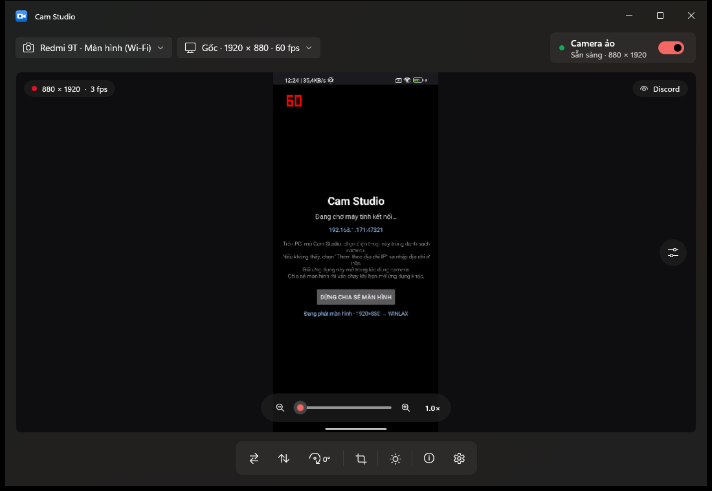
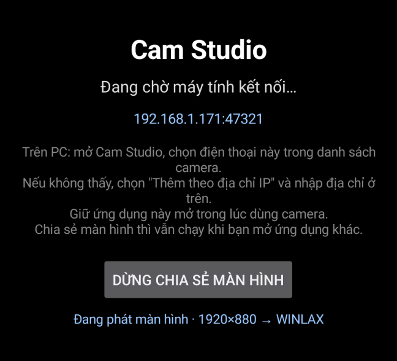
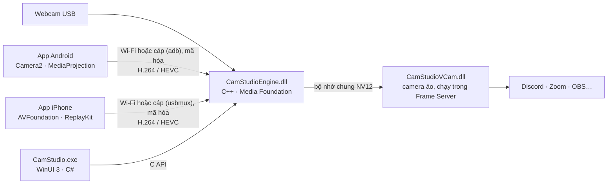

<div align="center">


# Cam Studio

**Biến webcam, điện thoại Android hay iPhone thành camera cho máy tính, ở đúng độ phân giải gốc của camera.**

Discord, Zoom, Teams, Google Meet, OBS và trình duyệt đều thấy một camera tên **"Cam Studio"**.

[](https://github.com/2108win/cam-studio/releases/latest)


[**⬇ Tải cho Windows**](https://github.com/2108win/cam-studio/releases/latest) · [**⬇ Tải cho Android**](https://github.com/2108win/cam-studio/releases/latest) · [Hướng dẫn iPhone](ios/README.md)



</div>

---

## Vì sao dùng Cam Studio

- **Độ phân giải gốc:** camera ảo phát đúng kích thước camera thật cho ra (1080p, 4K…), không bị ép xuống 720p.
- **Điện thoại làm webcam qua Wi‑Fi:** dùng được mọi ống kính của máy:
  - góc rộng, siêu rộng 0.6×, tele, macro, camera trước;
  - kể cả những ống kính mà Xiaomi/Redmi giấu đi với ứng dụng khác.
- **Hoặc cắm cáp USB:** Android và iPhone dùng được qua cáp, không cần Wi‑Fi. Hình ổn định hơn, điện thoại vừa được sạc.
- **Chia sẻ màn hình điện thoại:** màn hình Android hoặc iPhone hiện trên PC như một camera. Hình luôn đúng chiều khi xoay máy.
- **Điều khiển ngay trên khung hình:**
  - đổi ống kính, zoom, đèn flash, bù sáng, chạm để lấy nét;
  - chỉnh tay ISO, tốc độ màn trập, cân bằng trắng.
- **Chỉnh hình:** lật, xoay, cắt khung theo tỉ lệ, zoom số, chỉnh sáng, tương phản, độ bão hòa, nhiệt độ màu.
- **Rất nhẹ:** chỉ bật camera khi có ứng dụng dùng (xem [bên dưới](#nhẹ-và-tiết-kiệm)).
- **Không bị rớt camera:** khi điện thoại tạm ẩn app, mất Wi‑Fi, hay khi rút cáp webcam hoặc điện thoại, Discord vẫn giữ camera "Cam Studio" và hình tự quay lại khi nguồn sẵn sàng.
- **An toàn:**
  - ghép đôi bằng mã 6 số, so khớp trên cả hai máy;
  - mọi dữ liệu giữa điện thoại và PC đều mã hóa AES‑256‑GCM;
  - không đi qua máy chủ nào, mọi thứ ở trong mạng nhà bạn hoặc trên sợi cáp.

## Tải về và cài đặt

| Thiết bị | Tải | Cài đặt |
|---|---|---|
| **Windows 11** (64‑bit) | `CamStudio-Setup-<phiên bản>.exe` trong [Releases](https://github.com/2108win/cam-studio/releases/latest) | Bấm đúp file, bấm **Có** khi Windows hỏi quyền, rồi **Tiếp tục** đến hết. Không cần cài thêm .NET hay Visual C++. |
| **Android** 8.0 trở lên | `CamStudio-<phiên bản>-android.apk` | Chép sang điện thoại, mở file và cho phép cài. Cập nhật: cài đè lên bản cũ. |
| **iPhone** iOS 17 trở lên | build từ mã nguồn | Xem [ios/README.md](ios/README.md): build bằng Xcode trên Mac, hoặc bằng xtool trên Windows. |

> [!NOTE]
> Ứng dụng chưa có chữ ký số, nên Windows có thể hiện **"Windows protected your PC"**. Bấm **More info** rồi **Run anyway**.

Gỡ cài đặt trong **Settings › Apps › Installed apps › Cam Studio**.

## Bắt đầu nhanh

**Webcam USB hoặc capture card**
1. Mở **Cam Studio**, chọn camera ở góc trên bên trái.
2. Bật công tắc **Camera ảo**.
3. Trong Discord, Zoom, OBS…: chọn camera **Cam Studio**.

Lỡ rút cáp webcam: camera "Cam Studio" vẫn còn trong Discord, hình tự quay lại khi cắm lại (cổng USB khác cũng được).

**Điện thoại làm camera**
1. Cài app lên điện thoại. Điện thoại và máy tính phải dùng chung một mạng Wi‑Fi.
2. Mở app trên điện thoại. Trên PC, chọn tên điện thoại trong danh sách camera.
3. Lần đầu, hai máy hiện cùng một mã 6 số: bấm **Đồng ý** ở cả hai bên.
4. Bật **Camera ảo**. Đổi ống kính và zoom ngay trên khung hình.

**Điện thoại qua cáp USB** (không cần Wi‑Fi)
1. **Android:** bật **Gỡ lỗi USB** một lần:
   - vào **Cài đặt › Giới thiệu điện thoại**, bấm 7 lần vào **Số bản dựng** (Xiaomi/Redmi: **Phiên bản MIUI**) để mở **Tùy chọn nhà phát triển**;
   - trong **Tùy chọn nhà phát triển**, bật **Gỡ lỗi USB**;
   - cắm cáp vào PC, rồi chọn **Cho phép** khi điện thoại hỏi "Cho phép gỡ lỗi USB?".

   **iPhone:** cài app **Apple Devices** (Microsoft Store) hoặc iTunes trên PC. Cắm cáp, mở khóa iPhone, chọn **Tin cậy** nếu iPhone hỏi.
2. Mở app Cam Studio trên điện thoại. Trên PC, chọn **"<tên máy> (USB)"** trong danh sách camera. Muốn chia sẻ màn hình qua cáp thì bật chia sẻ màn hình trên điện thoại (xem dưới), rồi chọn **"<tên máy> · Màn hình (USB)"**.
3. Đã ghép đôi qua Wi‑Fi thì không phải ghép lại. Chưa ghép thì làm như bước 3 ở trên.
4. Rút cáp giữa chừng: camera ảo vẫn giữ, hình tự quay lại khi cắm lại. Cam Studio không tự chuyển sang Wi‑Fi: muốn dùng Wi‑Fi thì chọn nguồn **"(Wi‑Fi)"**.



**Chia sẻ màn hình điện thoại**
1. **Android:** trong app, bấm **Chia sẻ màn hình sang máy tính**, rồi bấm **Bắt đầu ngay**.
   **iPhone:** bấm nút chia sẻ màn hình trong app.
2. Trên PC, chọn nguồn **"<tên máy> · Màn hình"** (qua cáp: **"<tên máy> · Màn hình (USB)"**).
3. Bạn cứ dùng điện thoại bình thường, màn hình vẫn được chia sẻ. Bấm **Dừng** trong thông báo để tắt.

> [!TIP]
> - **Không thấy điện thoại?** Chọn **Thêm điện thoại theo địa chỉ IP…** rồi nhập địa chỉ hiện trên app điện thoại. Hoặc cắm cáp USB.
> - **Dùng camera điện thoại:** cần để app mở trên màn hình. Android và iOS không cho ứng dụng chạy nền dùng camera. App tự làm tối màn hình để đỡ tốn pin.

<br clear="right" />

## Nhẹ và tiết kiệm

Bật **Camera ảo** một lần là xong. Bạn không cần tự bật hay tắt:

- **Không có ứng dụng nào dùng camera và cửa sổ Cam Studio đang ẩn:**
  - nguồn hình đóng hẳn: webcam tắt đèn, điện thoại ngừng mã hóa và gửi hình;
  - camera "Cam Studio" vẫn có sẵn để ứng dụng khác chọn.
- **Khi Discord, Zoom… mở camera:** nguồn tự bật lại sau khoảng 0,5–2 giây.
- **Khi ứng dụng đó tắt camera:** 5 giây sau nguồn tự đóng.
- **Khi thu xuống khay:** bộ nhớ được trả lại cho Windows.

Đo trên PC thật, webcam 1920×1080 @ 100 fps:

| Trạng thái | CPU (một nhân) | RAM | Webcam |
|---|---|---|---|
| Đang mở cửa sổ, xem trước 100 fps | ~21% | ~165 MB | đang bật |
| **Ẩn xuống khay, không ứng dụng nào dùng** | **~0,1%** | **~45 MB** | **tắt** |
| Ẩn, phát màn hình điện thoại, chưa ai dùng | ~0,3% | ~47 MB | điện thoại không mã hóa |

Điện thoại Android qua cáp cần `adb` (có sẵn trong bộ cài). Cam Studio chỉ chạy nó khi có điện thoại bật Gỡ lỗi USB đang cắm vào. Nó tắt khoảng một phút sau khi rút điện thoại, hoặc khi thoát Cam Studio.

Nếu muốn Cam Studio luôn sẵn sàng: bật **Chạy cùng Windows** khi cài, hoặc trong **Cài đặt** của app. App sẽ chạy ẩn ở khay.

## Câu hỏi thường gặp

<details>
<summary><b>Discord, Zoom không thấy camera "Cam Studio"</b></summary>

Mở Cam Studio và bật **Camera ảo**. Sau đó chọn lại camera trong Discord hoặc Zoom (có ứng dụng phải tắt camera rồi bật lại mới thấy camera mới).
</details>

<details>
<summary><b>Báo lỗi "Không bật được camera ảo (0x80070005)"</b></summary>

Một ứng dụng (thường là Discord) vẫn giữ camera ảo cũ. Tắt camera trong ứng dụng đó rồi bật lại. Nếu vẫn lỗi, bấm nút **Khởi động lại dịch vụ camera** ngay trên thanh báo lỗi.
</details>

<details>
<summary><b>Hình bị ngược trái phải</b></summary>

Bấm nút **Lật ngang** ở thanh công cụ. Một số ứng dụng (Discord, Zoom) tự lật hình xem trước của bạn, nhưng người khác vẫn thấy hình đúng chiều.
</details>

<details>
<summary><b>Điện thoại báo "app bị ẩn" hoặc hình đứng</b></summary>

- **Camera điện thoại:** chỉ chạy khi app đang mở trên màn hình. Mở lại app, hình sẽ tự quay lại trên PC.
- **Chia sẻ màn hình:** chạy cả khi app ẩn.
</details>

<details>
<summary><b>Cắm cáp mà không thấy "(USB)" trong danh sách camera</b></summary>

- **Android:**
  - Bật **Gỡ lỗi USB** (xem [Bắt đầu nhanh](#bắt-đầu-nhanh)) và chọn **Cho phép** trên điện thoại.
  - Nếu danh sách chỉ hiện "Điện thoại Android – chờ cho phép gỡ lỗi USB": mở khóa điện thoại, rút ra cắm lại để hộp thoại hiện lại.
  - Đổi sang cáp truyền dữ liệu: cáp chỉ để sạc thì không được.
  - Một số máy cần driver USB của hãng trên Windows.
- **iPhone:** cài **Apple Devices** hoặc iTunes, mở khóa iPhone và chọn **Tin cậy**.
- Rồi bấm **Tìm lại camera và điện thoại**.
- **Chia sẻ màn hình qua cáp:** nguồn **"· Màn hình (USB)"** luôn có trong danh sách. Chọn nó khi chưa bật chia sẻ màn hình trên điện thoại thì PC báo lỗi: bật chia sẻ rồi chọn lại.
</details>

<details>
<summary><b>Điện thoại Xiaomi/Redmi thiếu ống kính siêu rộng hoặc macro</b></summary>

Cam Studio tự tìm các ống kính mà MIUI giấu đi. Ống kính nào điện thoại không cho mở thì sẽ không hiện, để tránh lỗi.
</details>

## Dành cho nhà phát triển



| Phần | Thư mục | Ngôn ngữ |
|---|---|---|
| Ứng dụng Windows | [`app/`](app/) | C# · WinUI 3 · .NET 10 |
| Engine: chụp, giải mã, xoay/cắt/chỉnh màu, kết nối điện thoại | [`src/engine/`](src/engine/) | C++ · Media Foundation |
| Camera ảo (Media Foundation virtual camera) | [`src/vcam/`](src/vcam/) | C++ · COM/WRL |
| App Android | [`android/`](android/) | Kotlin · Camera2 · MediaCodec |
| App iPhone | [`ios/`](ios/) | Swift · AVFoundation · VideoToolbox |
| Giao thức điện thoại ⇄ PC | [`docs/protocol.md`](docs/protocol.md) | — |
| Công cụ kiểm thử | [`src/verify/`](src/verify/), [`tools/`](tools/) | C++ · Swift · Python |

<details>
<summary><b>Build</b></summary>

**Windows** (cần Visual Studio 2022 Build Tools với C++, .NET SDK 10):
```powershell
powershell -ExecutionPolicy Bypass -File scripts\build.ps1           # engine, camera ảo, app
powershell -ExecutionPolicy Bypass -File scripts\register.ps1        # (Admin) đăng ký camera ảo cho bản build
```

**Android** (JDK 17, Android SDK 36):
```powershell
powershell -ExecutionPolicy Bypass -File scripts\build-android.ps1   # → build\CamStudioPhone.apk
```
Trên Mac hoặc Linux: `cd android && ./gradlew assembleRelease`.

**iPhone:** xem [ios/README.md](ios/README.md).

**Đóng gói bản phát hành** (cần [Inno Setup 6](https://jrsoftware.org/isinfo.php): `winget install JRSoftware.InnoSetup`, và Android SDK để lấy `adb` từ platform-tools):
```powershell
powershell -ExecutionPolicy Bypass -File scripts\package-release.ps1  # → build\dist: Setup.exe + APK
```
</details>

<details>
<summary><b>Kiểm thử</b></summary>

```powershell
build\Release\camstudio-protocol-test.exe                        # mật mã khớp từng byte với docs/protocol-vectors.json
build\Release\camstudio-verify.exe --device obsbot               # camera ảo có đúng độ phân giải gốc, hình có thật không
build\Release\camstudio-verify.exe --expect 1280x720 --mode 1    # đọc ở 30 fps như Discord; in số khung "no signal", nhịp khung
build\Release\camstudio-verify.exe --hold 60                     # giữ camera như một cuộc gọi
build\Release\camstudio-fake-phone.exe                           # điện thoại giả để thử PC không cần máy thật
build\Release\camstudio-dshow-consumer.exe                       # mở camera qua DirectShow như Discord
build\Release\camstudio-usb-check.exe list                       # điện thoại trên cáp USB (adb, Apple), tên máy
build\Release\camstudio-usb-check.exe hello <serial|UDID>        # mở đường ống qua cáp tới app, đổi "hello"
```
- **Android:** `gradlew testDebugUnitTest`
- **iOS:** scheme `CryptoTestsMac`
</details>

<details>
<summary><b>Dòng lệnh và gỡ lỗi</b></summary>

```powershell
CamStudio.exe --device obsbot     # chọn sẵn camera và bật camera ảo
CamStudio.exe --tray              # chạy ẩn ở khay
```
- **Cài đặt:** lưu ở `HKCU\Software\CamStudio`.
- **Khóa ghép đôi điện thoại:** lưu ở `%LOCALAPPDATA%\CamStudio`, được bảo vệ bằng DPAPI.
- **Log của camera ảo:** DLL chạy trong Frame Server, nên muốn xem log thì mở [DebugView](https://learn.microsoft.com/sysinternals/downloads/debugview) bằng quyền Admin, bật *Capture Global Win32*, rồi lọc theo `[CamStudioVCam]`.
</details>

---

<div align="center">
<sub>Toàn bộ mã nguồn được viết từ đầu: không dùng mã của Camo hay bất kỳ phần mềm thương mại nào.</sub>
</div>
